# OpenGameArt: Kenney 3D art

**53 assets from [OpenGameArt](https://opengameart.org), dedicated to the public domain under [CC0](https://creativecommons.org/publicdomain/zero/1.0/).** Use them in any game, free or paid, and change them however you like; no credit is needed.

3D art from OpenGameArt entries licensed CC0 (some also offer other licences; CC0 is the one that applies here). 519.2 MB in all.

This is a copy kept by [zuujis-cc0](https://github.com/zuujis-cc0) so game makers can take single files from GitHub. It is not made by or affiliated with OpenGameArt: the originals, often in more formats and higher resolutions, are on [opengameart.org](https://opengameart.org). If they help you, consider [supporting OpenGameArt](https://opengameart.org/content/faq).

Every file is listed in [MANIFEST.tsv](MANIFEST.tsv) with its size and SHA-256. More free assets: [the Zuujis collection](https://github.com/zuujis-cc0/free-game-assets#readme).

| | | | |
| :-: | :-: | :-: | :-: |
| <a href="3d-road-tile-pack">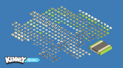</a> <b><a href="3d-road-tile-pack">3D Road Tile pack</a></b> by Kenney · <a href="https://opengameart.org/content/3d-road-tile-pack">source</a> | <a href="animated-characters-1">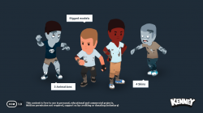</a> <b><a href="animated-characters-1">Animated Characters 1</a></b> by Kenney · <a href="https://opengameart.org/content/animated-characters-1">source</a> | <a href="animated-characters-2">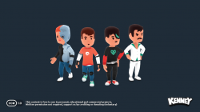</a> <b><a href="animated-characters-2">Animated Characters 2</a></b> by Kenney · <a href="https://opengameart.org/content/animated-characters-2">source</a> | <a href="animated-characters-3">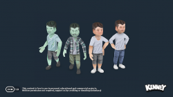</a> <b><a href="animated-characters-3">Animated Characters 3</a></b> by Kenney · <a href="https://opengameart.org/content/animated-characters-3">source</a> |
| <a href="blaster-kit">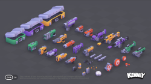</a> <b><a href="blaster-kit">Blaster Kit</a></b> by Kenney · <a href="https://opengameart.org/content/blaster-kit">source</a> | <a href="blocky-characters">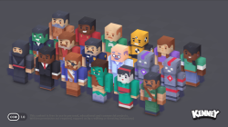</a> <b><a href="blocky-characters">Blocky Characters</a></b> by Kenney · <a href="https://opengameart.org/content/blocky-characters">source</a> | <a href="brick-kit">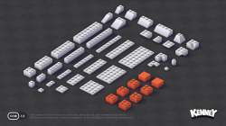</a> <b><a href="brick-kit">Brick Kit</a></b> by Kenney · <a href="https://opengameart.org/content/brick-kit">source</a> | <a href="building-kit">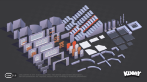</a> <b><a href="building-kit">Building Kit</a></b> by Kenney · <a href="https://opengameart.org/content/building-kit">source</a> |
| <a href="car-kit">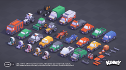</a> <b><a href="car-kit">Car Kit</a></b> by Kenney · <a href="https://opengameart.org/content/car-kit">source</a> | <a href="castle-kit">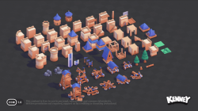</a> <b><a href="castle-kit">Castle Kit</a></b> by Kenney · <a href="https://opengameart.org/content/castle-kit">source</a> | <a href="city-kit-commercial">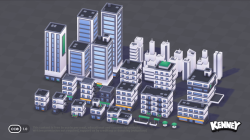</a> <b><a href="city-kit-commercial">City Kit (Commercial)</a></b> by Kenney · <a href="https://opengameart.org/content/city-kit-commercial">source</a> | <a href="city-kit-industrial">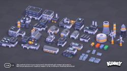</a> <b><a href="city-kit-industrial">City Kit (Industrial)</a></b> by Kenney · <a href="https://opengameart.org/content/city-kit-industrial">source</a> |
| <a href="city-kit-roads">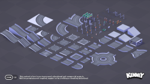</a> <b><a href="city-kit-roads">City Kit (Roads)</a></b> by Kenney · <a href="https://opengameart.org/content/city-kit-roads">source</a> | <a href="city-kit-suburban">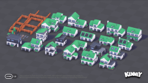</a> <b><a href="city-kit-suburban">City Kit (Suburban)</a></b> by Kenney · <a href="https://opengameart.org/content/city-kit-suburban">source</a> | <a href="coaster-kit">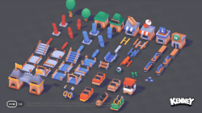</a> <b><a href="coaster-kit">Coaster Kit</a></b> by Kenney · <a href="https://opengameart.org/content/coaster-kit">source</a> | <a href="cube-pets">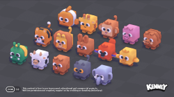</a> <b><a href="cube-pets">Cube Pets</a></b> by Kenney · <a href="https://opengameart.org/content/cube-pets">source</a> |
| <a href="factory-kit">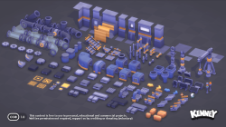</a> <b><a href="factory-kit">Factory Kit</a></b> by Kenney · <a href="https://opengameart.org/content/factory-kit">source</a> | <a href="fantasy-town-kit">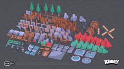</a> <b><a href="fantasy-town-kit">Fantasy Town Kit</a></b> by Kenney · <a href="https://opengameart.org/content/fantasy-town-kit">source</a> | <a href="food-kit">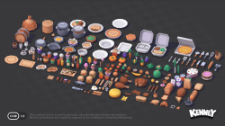</a> <b><a href="food-kit">Food Kit</a></b> by Kenney · <a href="https://opengameart.org/content/food-kit">source</a> | <a href="furniture-kit">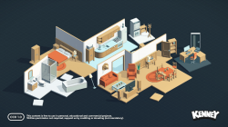</a> <b><a href="furniture-kit">Furniture Kit</a></b> by Kenney · <a href="https://opengameart.org/content/furniture-kit">source</a> |
| <a href="graveyard-kit">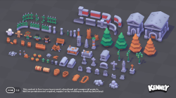</a> <b><a href="graveyard-kit">Graveyard Kit</a></b> by Kenney · <a href="https://opengameart.org/content/graveyard-kit">source</a> | <a href="hexagon-kit">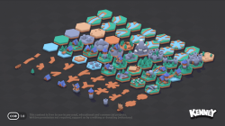</a> <b><a href="hexagon-kit">Hexagon Kit</a></b> by Kenney · <a href="https://opengameart.org/content/hexagon-kit">source</a> | <a href="holiday-kit">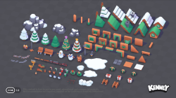</a> <b><a href="holiday-kit">Holiday Kit</a></b> by Kenney · <a href="https://opengameart.org/content/holiday-kit">source</a> | <a href="marble-kit">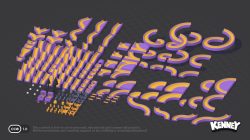</a> <b><a href="marble-kit">Marble Kit</a></b> by Kenney · <a href="https://opengameart.org/content/marble-kit">source</a> |
| <a href="mini-arcade">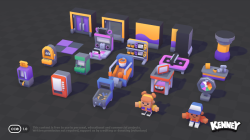</a> <b><a href="mini-arcade">Mini Arcade</a></b> by Kenney · <a href="https://opengameart.org/content/mini-arcade">source</a> | <a href="mini-arena">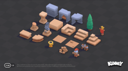</a> <b><a href="mini-arena">Mini Arena</a></b> by Kenney · <a href="https://opengameart.org/content/mini-arena">source</a> | <a href="mini-characters">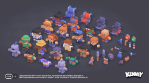</a> <b><a href="mini-characters">Mini Characters</a></b> by Kenney · <a href="https://opengameart.org/content/mini-characters">source</a> | <a href="mini-dungeon">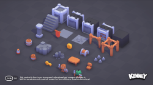</a> <b><a href="mini-dungeon">Mini Dungeon</a></b> by Kenney · <a href="https://opengameart.org/content/mini-dungeon">source</a> |
| <a href="mini-forest">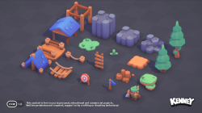</a> <b><a href="mini-forest">Mini Forest</a></b> by Kenney · <a href="https://opengameart.org/content/mini-forest">source</a> | <a href="mini-shop">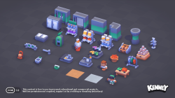</a> <b><a href="mini-shop">Mini Shop</a></b> by Kenney · <a href="https://opengameart.org/content/mini-shop">source</a> | <a href="mini-skate">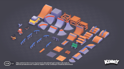</a> <b><a href="mini-skate">Mini Skate</a></b> by Kenney · <a href="https://opengameart.org/content/mini-skate">source</a> | <a href="minigolf-kit">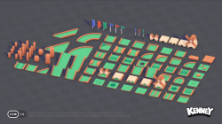</a> <b><a href="minigolf-kit">Minigolf Kit</a></b> by Kenney · <a href="https://opengameart.org/content/minigolf-kit">source</a> |
| <a href="modular-3d-buildings">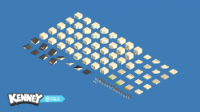</a> <b><a href="modular-3d-buildings">Modular (3D) buildings</a></b> by Kenney · <a href="https://opengameart.org/content/modular-3d-buildings">source</a> | <a href="modular-buildings">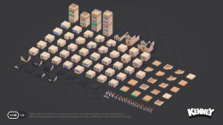</a> <b><a href="modular-buildings">Modular Buildings</a></b> by Kenney · <a href="https://opengameart.org/content/modular-buildings">source</a> | <a href="modular-cave-kit">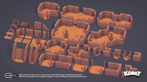</a> <b><a href="modular-cave-kit">Modular Cave Kit</a></b> by Kenney · <a href="https://opengameart.org/content/modular-cave-kit">source</a> | <a href="modular-dungeon-kit">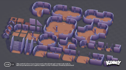</a> <b><a href="modular-dungeon-kit">Modular Dungeon Kit</a></b> by Kenney · <a href="https://opengameart.org/content/modular-dungeon-kit">source</a> |
| <a href="modular-space-kit">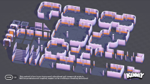</a> <b><a href="modular-space-kit">Modular Space Kit</a></b> by Kenney · <a href="https://opengameart.org/content/modular-space-kit">source</a> | <a href="nature-kit">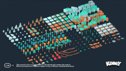</a> <b><a href="nature-kit">Nature Kit</a></b> by Kenney · <a href="https://opengameart.org/content/nature-kit">source</a> | <a href="pirate-kit">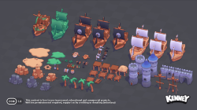</a> <b><a href="pirate-kit">Pirate Kit</a></b> by Kenney · <a href="https://opengameart.org/content/pirate-kit">source</a> | <a href="platformer-kit">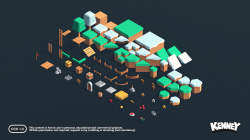</a> <b><a href="platformer-kit">Platformer Kit</a></b> by Kenney · <a href="https://opengameart.org/content/platformer-kit">source</a> |
| <a href="platformer-kit-0">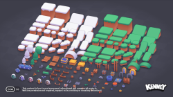</a> <b><a href="platformer-kit-0">Platformer Kit</a></b> by Kenney · <a href="https://opengameart.org/content/platformer-kit-0">source</a> | <a href="prototype-kit">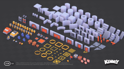</a> <b><a href="prototype-kit">Prototype Kit</a></b> by Kenney · <a href="https://opengameart.org/content/prototype-kit">source</a> | <a href="racing-kit">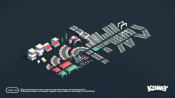</a> <b><a href="racing-kit">Racing Kit</a></b> by Kenney · <a href="https://opengameart.org/content/racing-kit">source</a> | <a href="retro-medieval-kit">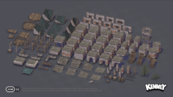</a> <b><a href="retro-medieval-kit">Retro Medieval Kit</a></b> by Kenney · <a href="https://opengameart.org/content/retro-medieval-kit">source</a> |
| <a href="retro-urban-kit">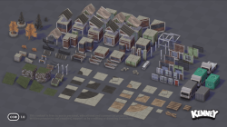</a> <b><a href="retro-urban-kit">Retro Urban Kit</a></b> by Kenney · <a href="https://opengameart.org/content/retro-urban-kit">source</a> | <a href="space-kit">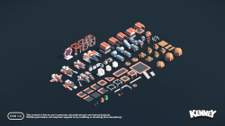</a> <b><a href="space-kit">Space Kit</a></b> by Kenney · <a href="https://opengameart.org/content/space-kit">source</a> | <a href="space-kit-remade">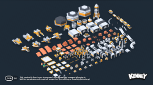</a> <b><a href="space-kit-remade">Space Kit (remade)</a></b> by Kenney · <a href="https://opengameart.org/content/space-kit-remade">source</a> | <a href="space-station-kit">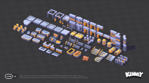</a> <b><a href="space-station-kit">Space Station Kit</a></b> by Kenney · <a href="https://opengameart.org/content/space-station-kit">source</a> |
| <a href="survival-kit">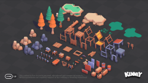</a> <b><a href="survival-kit">Survival Kit</a></b> by Kenney · <a href="https://opengameart.org/content/survival-kit">source</a> | <a href="tower-defense-kit">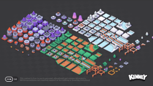</a> <b><a href="tower-defense-kit">Tower Defense Kit</a></b> by Kenney · <a href="https://opengameart.org/content/tower-defense-kit">source</a> |  <b><a href="toy-car-kit">Toy Car Kit</a></b> by Kenney · <a href="https://opengameart.org/content/toy-car-kit">source</a> |  <b><a href="train-kit">Train Kit</a></b> by Kenney · <a href="https://opengameart.org/content/train-kit">source</a> |
|  <b><a href="watercraft-kit">Watercraft Kit</a></b> by Kenney · <a href="https://opengameart.org/content/watercraft-kit">source</a> |  |  |  |

---

Kept up to date by this repository's own [update workflow](.github/workflows/update.yml), with code and plan from [cc0-mirror](https://github.com/zuujis-cc0/cc0-mirror). Something wrong? [Open an issue there](https://github.com/zuujis-cc0/cc0-mirror/issues/new) or use the [private report form](https://games.zuujis.com/report).
